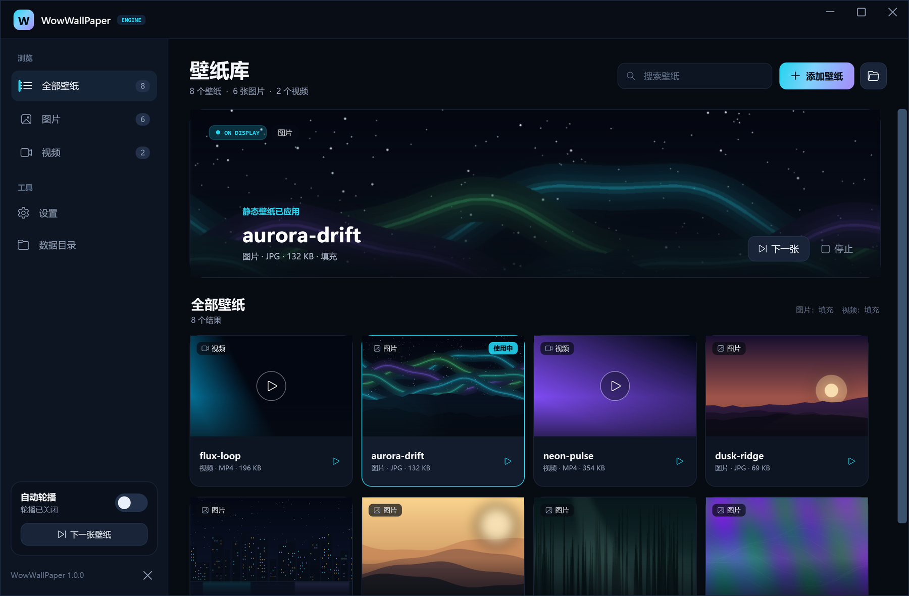
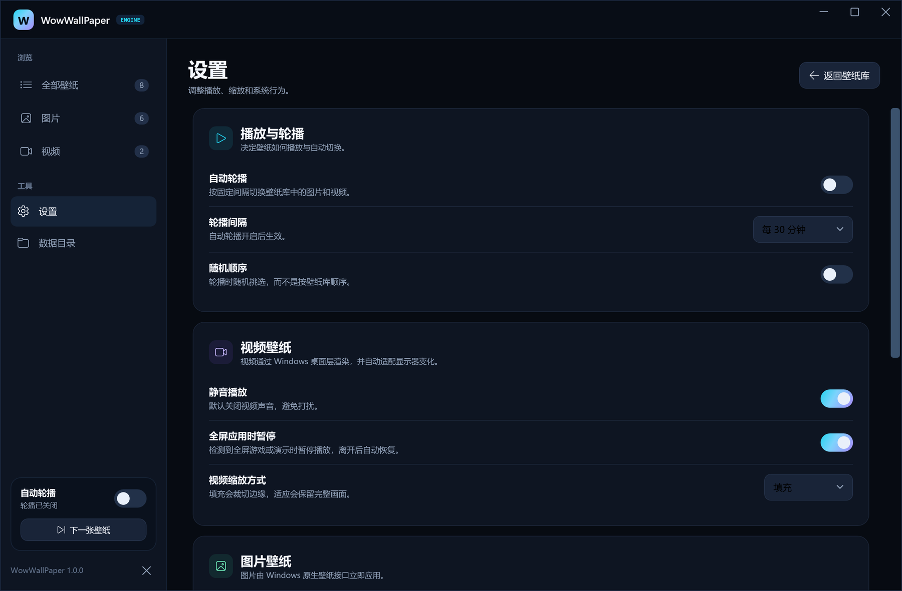

# WowWallPaper

一个原生 Windows 图片 / 视频桌面壁纸引擎。添加本地图片或视频，一键设为桌面壁纸；支持壁纸库、自动轮播、多显示器、系统托盘、开机启动和资源管理器重启后的自动恢复。





## 功能

- **图片壁纸**：通过 Windows 原生 `IDesktopWallpaper` 接口应用，失败时回退到 `SystemParametersInfo`。支持填充、适应、拉伸、居中、平铺。
- **视频壁纸**：使用 LibVLC 将视频直接渲染到 Windows 桌面层，位于桌面图标下方；Windows 11 的 raised desktop（Progman 无重定向表面）使用分层子窗口，图标仍可正常使用。
- **多显示器**：视频为每个显示器创建独立桌面子窗口；图片使用 Windows 原生全桌面设置。
- **壁纸库**：导入图片 / 视频、导入整个文件夹、拖拽添加、搜索、按类型筛选、移除记录。
- **预览图**：通过 Windows Shell 缩略图接口生成图片和视频封面，缓存在本地，滚动更快。
- **自动轮播**：按 1 分钟到 24 小时的间隔切换，可随机顺序；手动“下一张”会重置轮播计时。
- **视频体验**：默认静音、循环播放、全屏应用时自动暂停、系统锁屏 / 睡眠时自动暂停。
- **可靠恢复**：监视 Explorer 重启、显示器变化和桌面窗口失效，自动重新挂载动态壁纸。
- **托盘与启动**：关闭窗口可最小化到托盘，可设置开机自动启动，支持单实例运行。
- **深色现代界面**：自绘标题栏、圆角卡片、深色下拉框 / 开关 / 滚动条，支持高 DPI。

## 系统要求

- Windows 10 1809+ 或 Windows 11（64 位）。
- Windows 资源管理器正在运行（视频壁纸必须）。
- **不要以管理员身份运行**。动态壁纸需要把子窗口挂到当前用户的 Explorer 桌面层，提权后可能无法跨完整性级别挂载。
- 视频播放由随包附带的 LibVLC 提供，支持 MP4、MKV、WebM、AVI、MOV 等常见容器和编码，实际能力取决于 LibVLC 自带解码器。
- **发布包必须保留 `libvlc` 文件夹**，不能只复制 `WowWallPaper.exe`。
- 使用框架依赖版本时需要 [.NET 10 Desktop Runtime](https://dotnet.microsoft.com/download/dotnet/10.0)；自包含版本无需额外安装运行时。
- 发布的可执行文件未做代码签名，首次运行时 Windows SmartScreen 可能提示“未知发布者”；确认来源后选择“更多信息 → 仍要运行”。

## 使用

1. 点击右上角 **添加壁纸**，选择图片或视频；也可以把文件（或文件夹里的文件）拖进窗口。
2. 单击卡片或卡片右下角的应用按钮。
3. 需要更换缩放方式、轮播、静音或开机启动时，打开左侧 **设置**。
4. 关闭窗口会缩到托盘；托盘菜单可以打开主界面、切下一张、暂停 / 继续、静音、停止壁纸或退出。
5. **停止壁纸** 会恢复应用启动时记录的 Windows 原始壁纸；如果原始壁纸路径无法读取，则保持当前桌面壁纸不变。

## 下载

预编译的自包含版本发布在 [GitHub Releases](https://github.com/ChenzhongJi/WowWallPaper/releases/latest)。下载后请**完整解压整个文件夹**，保留 `libvlc` 子目录，再运行 `WowWallPaper.exe`。

> **开机恢复**：从 1.0.1 起，开机自动启动默认开启。视频壁纸要在重启后继续显示，应用必须在登录 Windows 后运行；如果关闭“开机自动启动”，重启后需要手动打开应用。

支持的图片扩展名：`jpg / jpeg / jfif / png / bmp / gif / webp / tif / tiff`。  
支持的视频扩展名：`mp4 / m4v / wmv / avi / mov / mpg / mpeg / mkv / webm`。  
注意：扩展名在筛选器中可用，不代表系统一定装有对应解码器。

## 构建与运行

### 从源码运行

需要 .NET 10 SDK 和 Windows。

```powershell
dotnet build WowWallPaper.slnx
dotnet run --project src/WowWallPaper/WowWallPaper.csproj
```

或：

```powershell
powershell -ExecutionPolicy Bypass -File scripts/build.ps1 -Configuration Debug
```

### 发布

视频壁纸需要 LibVLC 原生文件，因此默认发布为**文件夹版本**：

```powershell
powershell -ExecutionPolicy Bypass -File scripts/publish.ps1 -Runtime win-x64 -Zip
```

自包含文件夹版本（不要求用户预装 .NET，体积更大）：

```powershell
powershell -ExecutionPolicy Bypass -File scripts/publish.ps1 -Runtime win-x64 -SelfContained -Zip
```

输出位于 `dist/`，运行时目录中应包含 `WowWallPaper.exe`、`libvlc\win-x64\` 以及 .NET 运行时文件。解压后请保留整个文件夹结构。

> **更新已有安装时不要只覆盖 `WowWallPaper.exe`。** 视频壁纸需要同目录的 `libvlc` 文件夹；请把新 zip 完整解压覆盖原安装目录（例如 `D:\Software\WowWallpaper`），保留 `libvlc` 和所有运行时文件。

## 数据与隐私

应用不访问网络，不移动或复制你选择的图片 / 视频，只保存文件路径。

数据目录：

```text
%LOCALAPPDATA%\WowWallPaper\
├─ settings.json     # 壁纸库、当前壁纸、缩放和轮播设置
├─ thumbnails\       # 本地缩略图缓存
└─ logs\app.log      # 运行日志，单个文件超过 2 MB 会轮转
```

如果 `%LOCALAPPDATA%\WowWallPaper` 不可写（例如通过受限的文件预览、沙箱或只读配置启动），应用会自动回退到：

```text
<exe 所在目录>\WowWallPaperData\
```

如果程序目录也不可写，再回退到 `%TEMP%\WowWallPaperData\`。启动时的提示和 `logs\app.log` 会显示真正使用的目录。

如需使用独立配置（例如做演示或测试），可以设置环境变量：

```powershell
$env:WOWWALLPAPER_DATA_DIR = 'D:\WowWallPaper-Data'
```

然后重新启动应用。

## 实现概览

- **静态图片**：`Services/NativeWallpaperService.cs` 使用 `IDesktopWallpaper`（CLSID `C2CF3110-460E-4fc1-B9D0-8A1C0C9CC4BD`）设置壁纸与显示位置；COM 不可用时回退到注册表 + `SystemParametersInfo(SPI_SETDESKWALLPAPER)`。
- **动态视频**：`Services/VlcVideoWallpaperService.cs`
  - 向 `Progman` 发送未公开消息 `0x052C`（`0xD/0x1`），让 Explorer 创建壁纸 WorkerW。
  - Windows 11 raised desktop：`Progman` 为 `WS_EX_NOREDIRECTIONBITMAP`，`SHELLDLL_DefView` 为分层窗口。应用为每个显示器创建原生窗口，设置 `WS_EX_LAYERED`，挂到 `Progman`，并放在 `SHELLDLL_DefView` 下方、WorkerW 上方，从而让视频显示在图标下方。
  - 视频通过 LibVLC 直接渲染到原生 HWND；每个显示器一个 `MediaPlayer`，主显示器输出音频。
  - 1 秒健康检查：桌面宿主失效、显示器变化时重建；全屏应用 / 锁屏 / 睡眠时暂停；视频循环播放。
- **缩略图**：`Services/ThumbnailService.cs` 对图片优先使用 WPF 解码，对视频使用 `IShellItemImageFactory`；后台 STA 线程生成，冻结后交给 UI，结果写入缓存。
- **设置**：`System.Text.Json` 原子写入本地配置文件，枚举以可读字符串保存。
- **单实例**：命名互斥量 + 本地事件；第二次启动会唤起已有窗口。
- **开机启动**：写入 `HKCU\Software\Microsoft\Windows\CurrentVersion\Run`。

## 排查

| 现象 | 建议 |
| --- | --- |
| 启动时提示“无法创建本地数据目录”或“无法启动” | 使用最新发布包；应用会自动切换到 `WowWallPaperData` 便携目录。若仍失败，请把程序放到可写目录（如桌面或文档文件夹）再运行。 |
| 设置壁纸失败，提示“Windows 拒绝修改桌面壁纸” | 当前进程被 Windows 以低完整性/受限沙箱运行，系统不允许修改壁纸。请先托盘退出，再从资源管理器直接双击 exe，**不要从聊天文件预览或受限沙箱启动**；也不要管理员运行。应用检测到这种环境时会在顶部显示常驻警告。 |
| 视频壁纸没有出现，或提示“正在等待 Windows 桌面层” | 确认 Explorer 正在运行；不要以管理员身份启动；确认 `libvlc\win-x64\` 与 exe 一起存在；尝试重启应用。 |
| 视频壁纸启动但桌面没有变化 | 查看 `app.log` 中是否有 `VLC state: Playing` 和 `VLC desktop host acquired ... raised-layered`。若日志显示 Low Integrity，请从资源管理器正常启动，不要从聊天文件预览/沙箱启动。 |
| 视频黑屏 / 无法播放 | 视频编码可能不受 LibVLC 支持。用 FFmpeg 转成 H.264 MP4：`ffmpeg -i input.mkv -c:v libx264 -pix_fmt yuv420p -c:a aac output.mp4`。 |
| 重启后视频壁纸消失 | 1.0.1 起“开机自动启动”默认开启，应用会在登录后自动恢复上次壁纸。若仍消失：打开设置确认开机自动启动未被关闭；在 Windows 设置 → 应用 → 启动中确认 WowWallPaper 未被禁用；查看日志是否有 `Startup=True` 和 `VLC state: Playing`。 |
| 重启 Explorer 后视频消失 | 正常情况下健康检查会自动重新挂载；如未恢复，查看 `app.log` 中 VLC host 相关记录。 |
| 关闭窗口后找不到应用 | 查看系统托盘溢出区，双击托盘图标打开；或在托盘菜单退出。 |

## 已知限制

- 所有显示器播放同一个视频；暂不支持每个显示器独立视频。
- 只有静音开关，没有音量滑杆。
- 图片壁纸作用于 Windows 当前桌面，不修改锁屏壁纸。
- 动态壁纸停止或应用退出后，桌面会回到底层 Windows 壁纸；不会自动把视频暂停帧固化为静态图片。
- 桌面壁纸 API、WorkerW 消息和全屏检测使用 Windows 未公开或行为可能变化的接口。应用已对常见失败做回退和重试，但不同 Windows 版本 / 定制 Shell 仍可能存在差异。

## 开发说明

项目结构：

```text
src/WowWallPaper/
├─ Models/         # 配置、枚举、壁纸条目
├─ Interop/        # Win32 / COM P/Invoke
├─ Services/       # 壁纸应用、视频层、缩略图、托盘、设置、启动
├─ ViewModels/     # MVVM 状态与命令
├─ Converters/     # XAML 绑定转换器
├─ Themes/         # 深色主题资源
├─ MainWindow.xaml # 壁纸库与设置界面
└─ App.xaml.cs     # 单实例、生命周期、托盘、启动恢复
```

调试参数（仅用于开发验证）：

```text
--startup                 模拟开机启动（不显示主窗口）
--screenshot <path>       初始化后把界面渲染为 PNG 并退出
--settings                配合 --screenshot 打开设置页
```

视频引擎联调时，可通过环境变量 `WOWWALLPAPER_HOST_HWND` 指定一个测试桌面宿主窗口句柄；正常使用不需要设置。

## 许可证

本项目使用 [MIT License](LICENSE)。

---

WowWallPaper 1.0.1 · 原生 Windows 壁纸引擎
